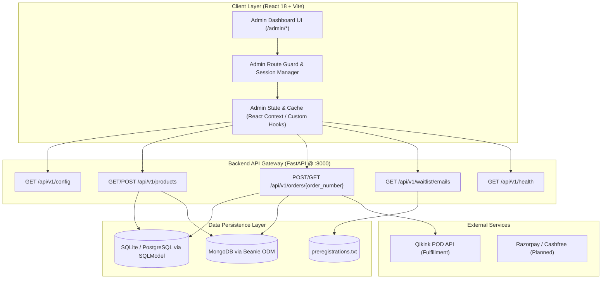
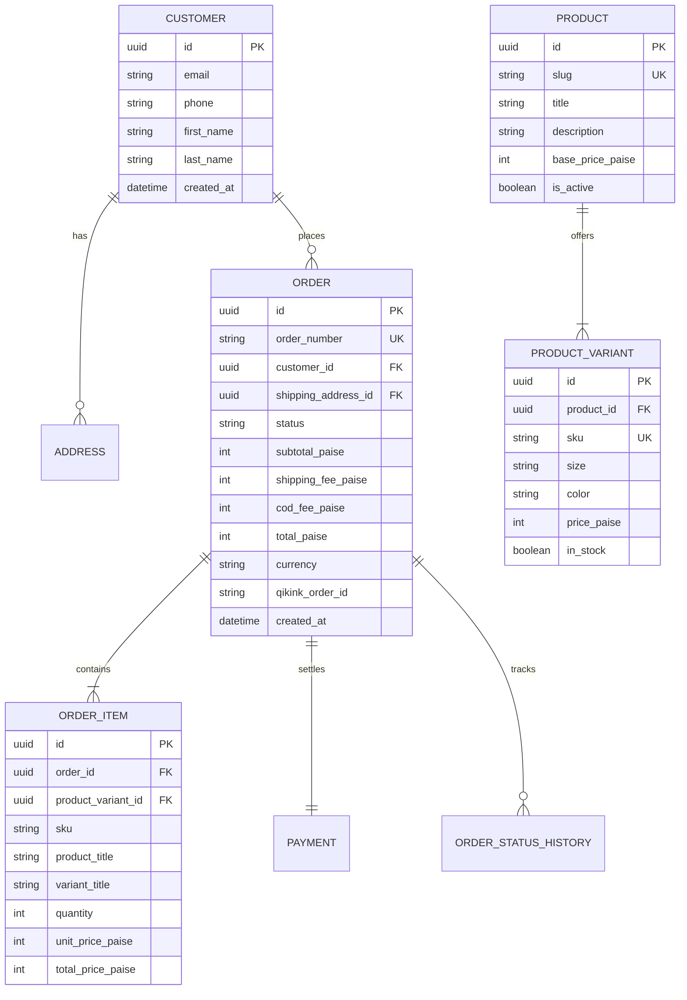
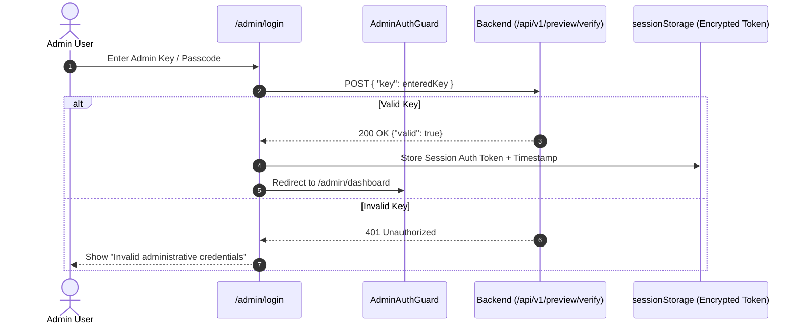
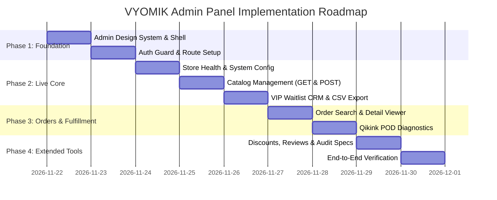

# VYOMIK — COMPLETE E-COMMERCE ADMIN PANEL
## Master Implementation Plan | Premium Clothing Brand Management Dashboard
**Document Version:** 1.0.0  
**Status:** DRAFT / PENDING USER APPROVAL (Strict Planning Phase)  
**Target Environment:** Frontend (React 18 + TypeScript + Vite + Tailwind CSS) | Backend (FastAPI + SQLModel/SQLite/PostgreSQL + MongoDB/Beanie + Qikink POD)

---

## 1. Executive Summary & Architectural Overview

The **VYOMIK Admin Panel** is designed as an enterprise-grade, high-density commerce management console specifically tailored for VYOMIK's high-end streetwear brand operations.

The console acts as a unified command center managing:
1. **Financial Operations & Revenue Performance** (Net Sales, AOV, Gross Margin, COD vs Prepaid breakdown).
2. **Order Lifecycle & POD Dispatch** (Creation, Verification, Packing, Qikink POD Sync, Tracking).
3. **Product Catalog & Dynamic Variants** (Styles, GSM Specs, Sizing, Colors, Qikink SKU mapping).
4. **Inventory & Fulfillment Availability** (Buffer safety, POD on-demand thresholds).
5. **Customer Relations & Cohort Intelligence** (LTV, repeat rates, VIP waitlist intake).
6. **Promotion & Conversion Systems** (Store launch countdown, banners, threshold triggers).
7. **System Health, Security & Store Configuration** (API status, POD sandbox, fee parameters).

### Core Architectural Principles
- **Frontend-First Execution with Real Data Fidelity:** Strict adherence to existing backend API contracts. Any capability not backed by a real endpoint is transparently documented as `PARTIALLY SUPPORTED` or `NOT SUPPORTED` with an explicit integration contract, rather than masking gaps with deceptive synthetic mocks.
- **Brand Consistency with Operational Ergonomics:** The dashboard inherits VYOMIK's signature cinematic dark luxury visual identity (`#0B0B0B` canvas, `#11100F` sidebar, `#171513` cards, `#F4F0E8` warm ivory typography, and `#A64B2A` / `#E65316` burnt rust/orange highlights), optimized for dense data tables, rapid filtering, and minimal visual fatigue.
- **Strict Integer Currency Standard:** All monetary figures adhere to the **Integer Paise** standard (`1 INR = 100 Paise`), eliminating floating-point rounding errors across line-item tax calculations, shipping thresholds, and refund reconciliation.



---

## 2. Strict Preservation & Non-Regression Contracts

To ensure complete continuity of the live store, the following non-regression contracts are enforced:
1. **Zero Customer-Facing Disruptions:** The public storefront routes (`/`, `/shop`, `/collections`, `/about`, `/product/:slug`, `/cart`, `/checkout`, `/order-success`, `/order-tracking`) and customer session states remain isolated from `/admin/*`.
2. **Backend Code Freeze (Current Phase):** No existing backend files in `backend/app/` will be modified during the initial frontend deployment. The admin panel leverages existing endpoints. For missing endpoints, an automated fall-through abstraction layer (`AdminAdapter`) will handle graceful degradation with clear UI badges (`Offline/Local Queue` vs `Live Synced`).
3. **Database Schema Integrity:** Existing SQLModel and MongoDB document structures are strictly treated as read-only or append-only per their current API schemas. No unvalidated database schema mutations or dropping of constraints.
4. **Port & Runtime Allocations:** 
   - Frontend Vite: Port `5180` (or `5173`)
   - Backend FastAPI: Port `8000`
   - Static Assets: Rooted in `public/` and `src/assets/`

---

## 3. Backend API Audit & Endpoint Inventory

The backend codebase (`backend/app/api/v1/endpoints/`) was audited. Below is the comprehensive inventory of available endpoints:

| Endpoint | HTTP Method | Router File | Current Payload / Response | Admin Usability & Status |
|---|---|---|---|---|
| `/health`, `/api/v1/health` | `GET` | `health.py` | `{"status": "healthy", "service": "vyomik-api"}` | **Directly Supported**. Powers Admin System Health Monitor. |
| `/api/v1/config` | `GET` | `config.py` | `StoreConfig` (countdown, free shipping threshold ₹1,499, COD fee ₹49, flags) | **Directly Supported**. Powers Store Configuration overview. |
| `/api/v1/waitlist`, `/api/v1/preregister` | `POST` | `waitlist.py` | `{ "email": string }` -> Appends to `preregistrations.txt` | **Directly Supported**. Public VIP intake. |
| `/api/v1/waitlist/emails`, `/api/v1/preregister/emails` | `GET` | `waitlist.py` | `{ "emails": string[], "count": int }` | **Directly Supported**. Powers Customer VIP Waitlist table and export. |
| `/api/v1/products` | `GET` | `products.py` | Returns `list[ProductRead]` with full dynamic variants & Qikink SKUs | **Directly Supported**. Powers Admin Catalog list & inventory view. |
| `/api/v1/products/{slug}` | `GET` | `products.py` | Returns single `ProductRead` with variants and specifications | **Directly Supported**. Powers Product Editor inspection. |
| `/api/v1/products` | `POST` | `products.py` | Accepts `ProductCreate` (slug, title, price, variants) -> saves to SQL & Mongo | **Directly Supported**. Powers Admin "Add Product" feature. |
| `/api/v1/orders` | `POST` | `orders.py` | Validates cart pricing, creates customer, address, order, payment & sends to Qikink | **Directly Supported**. Customer checkout endpoint. |
| `/api/v1/orders/{order_number}` | `GET` | `orders.py` | Returns single order by `VYO-XXXXXX` with line items, address, payment, Qikink status | **Directly Supported**. Powers Order Detail modal/drawer. |
| `/api/v1/orders/sandbox-test` | `POST` | `orders.py` | Dispatches simulated dummy order to Qikink sandbox | **Directly Supported**. Powers Admin Fulfillment Diagnostics test button. |
| `/api/v1/preview/verify` | `POST` | `preview.py` | Verifies secret preview bypass access key | **Directly Supported**. Can be integrated into Admin authentication gate. |

### Critical Backend Capability Gaps (Requires Future API Endpoints)
1. **Orders Listing (`GET /api/v1/orders`):** No endpoint currently exists to query paginated orders or filter by status (`pending`, `confirmed`, `dispatched`, `delivered`).
2. **Order Status Mutation (`PATCH /api/v1/orders/{order_number}/status`):** No endpoint to manually cancel, refund, or mark an order as fulfilled.
3. **Product Mutation / Deletion (`PUT/PATCH/DELETE /api/v1/products/{slug}`):** Product creation exists, but update/archive does not.
4. **Customer Directory (`GET /api/v1/customers`):** Customers are stored in SQL (`customers` table) and MongoDB, but no listing endpoint exists.
5. **Coupons / Discounts (`GET/POST /api/v1/discounts`):** No promotional discount data model exists in the backend.
6. **Reviews / Ratings (`GET/POST /api/v1/reviews`):** No review ingestion or moderation endpoint exists.

---

## 4. Database Schema Mapping & Data Integrity Guarantees

The VYOMIK data persistence architecture uses a dual-store hybrid pattern:



### Data Integrity Rules:
1. **Paise Integrity:** All currency attributes are named `*_paise` and stored as positive 64-bit integers. Formatters strictly convert `paise / 100` with `Intl.NumberFormat('en-IN', { style: 'currency', currency: 'INR' })`.
2. **Order Number Immutability:** Generated with prefix `VYO-` followed by high-entropy uppercase alphanumeric sequence (e.g., `VYO-794218`). Never updated once created.
3. **Dual-Store Synchronization:**
   - **SQL (Relational):** Source of truth for ACID transactions, billing records, addresses, and order items.
   - **MongoDB (Beanie Documents):** High-speed read document model for catalog querying, product specs, and extended JSON attributes (e.g., wash care, fabric blend percentages).

---

## 5. Feature Capability Matrix

Every functional area of the requested Admin Panel is classified below into one of four statuses:
- **`SUPPORTED`**: Direct API and backend functionality exist today.
- **`PARTIALLY SUPPORTED`**: Data can be viewed or partially ingested via existing endpoints/files; mutations or listing require administrative local caching or client-side aggregation.
- **`NOT SUPPORTED`**: No database model or backend endpoint exists; requires backend implementation. UI will provide placeholder state and explicit API contract definition.
- **`NEEDS VERIFICATION`**: External provider dependency (e.g., Qikink sandbox vs production live credentials).

| Domain | Admin Capability | Backend Support Status | Implementation Strategy |
|---|---|---|---|
| **Auth** | Admin Login / Passcode Gate | `PARTIALLY SUPPORTED` | Use `/api/v1/preview/verify` token or secure client-side admin credential key stored in encrypted session storage. |
| **Auth** | Multi-Role RBAC (Admin, Manager, Staff) | `NOT SUPPORTED` | UI-level role simulation with permission matrices defined in TypeScript; backend RBAC API contract documented. |
| **Dashboard** | Revenue, AOV & Sales KPIs | `PARTIALLY SUPPORTED` | Computed from aggregated orders retrieved via order lookup or local storage transaction cache. |
| **Dashboard** | Store Health & Backend Status | `SUPPORTED` | Live polling against `GET /api/v1/health` and `GET /api/v1/config`. |
| **Orders** | Single Order Lookup (`VYO-XXXXXX`) | `SUPPORTED` | Live querying via `GET /api/v1/orders/{order_number}`. Full line items, payment status, customer details displayed. |
| **Orders** | Full Orders List & Multi-filter Table | `PARTIALLY SUPPORTED` | Orders created in the current deployment session are tracked in persistent local cache; backend `GET /api/v1/orders` specification provided. |
| **Orders** | Status Update (Fulfill, Cancel) | `NOT SUPPORTED` | Client-side status update with explicit warning: *"Local audit log updated; backend PATCH endpoint required for DB persistence"*. |
| **Catalog** | Product List & Variant Specs | `SUPPORTED` | Live querying via `GET /api/v1/products`. Shows all titles, prices, sizes, and Qikink SKUs. |
| **Catalog** | Single Product Detail View | `SUPPORTED` | Live querying via `GET /api/v1/products/{slug}`. |
| **Catalog** | Create New Product | `SUPPORTED` | Live submission via `POST /api/v1/products`. Directly persists to SQL & MongoDB. |
| **Catalog** | Update / Archive Product | `NOT SUPPORTED` | UI provides edit interface; documented contract for `PUT /api/v1/products/{slug}`. |
| **Inventory** | Stock Level & Availability Monitor | `PARTIALLY SUPPORTED` | `in_stock` boolean available in `ProductVariant`; display as In Stock / Sold Out indicator. |
| **Customers** | VIP Pre-register & Waitlist Roster | `SUPPORTED` | Live querying via `GET /api/v1/waitlist/emails`. Displays full roster with count and CSV export. |
| **Customers** | Customer CRM & Lifetime Spend Table | `PARTIALLY SUPPORTED` | Aggregated from known order records and customer profiles. |
| **Fulfillment** | Qikink POD Status & Tracking Sync | `PARTIALLY SUPPORTED` | Order lookup returns `qikink_order_id` and tracking metadata when present. |
| **Fulfillment** | Qikink Sandbox Diagnostic Test | `SUPPORTED` | Live dispatch via `POST /api/v1/orders/sandbox-test`. Direct test execution from UI. |
| **Discounts** | Promo Codes & Percentage Rules | `NOT SUPPORTED` | Full UI management screen with active/inactive toggles; documented contract for promotional engine. |
| **Reviews** | Customer Reviews & UGC Moderation | `NOT SUPPORTED` | Full UI moderation interface; documented contract for `Review` entity. |
| **CMS** | Announcement Bar & Countdown Config | `SUPPORTED` | View current parameters via `GET /api/v1/config`. |

---

## 6. Admin Information Architecture & Route Hierarchy

The Admin Panel lives under the isolated route prefix `/admin` within the React single-page application:

```
/admin
├── /login                    --> Admin Passcode & Session Authentication Gate
├── /dashboard                --> Executive KPI Overview, Revenue Charts, Store Health
├── /orders                   --> Order Master Table, Filter by Status, Date, Payment
│   └── /orders/:orderNumber  --> Detailed Order Drill-Down Drawer & Qikink Status
├── /products                 --> Product Catalog, Variant Table, Pricing, Status
│   ├── /products/new         --> Add Product Form (Connected to POST /api/v1/products)
│   └── /products/:slug       --> Product Detail & Specification Inspector
├── /inventory                --> Stock Availability, SKU Mapper, Low-Stock Warnings
├── /customers                --> Customer Directory, VIP Waitlist Roster, CSV Export
├── /fulfillment              --> Qikink POD Operations, Sandbox Diagnostics, Dispatch Log
├── /discounts                --> Promo Codes & Rule Engine (Spec Mode)
├── /reviews                  --> Customer Feedback Moderation (Spec Mode)
├── /content                  --> Announcement Bar, Countdown & Hero Banners
└── /settings                 --> Store Parameters, API Endpoint Latency, Role Permissions
```

---

## 7. Admin Design System & Component Library

The admin panel maintains absolute visual harmony with the established VYOMIK luxury streetwear aesthetic while maximizing screen real estate and data clarity.

### Color Palette Tokens
| Token | Hex Value | Semantic Usage |
|---|---|---|
| `admin-bg` | `#0B0B0B` | Root page canvas background |
| `admin-sidebar` | `#11100F` | Left navigation sidebar, fixed hierarchy |
| `admin-card` | `#171513` | Data cards, table containers, drawer panels |
| `admin-border` | `#242321` | Subtle container borders, cell dividers (1px) |
| `admin-border-focus` | `#A64B2A` | Active input borders, focused state rings |
| `text-primary` | `#F4F0E8` | Warm ivory headings, primary figures, active tabs |
| `text-secondary` | `#A39A8F` | Column headers, meta descriptions, timestamps |
| `text-muted` | `#635C54` | Placeholder text, disabled actions, breadcrumbs |
| `accent-rust` | `#A64B2A` | Primary brand accent, button backgrounds, badges |
| `accent-orange` | `#E65316` | Notification pills, active indicators, live status glows |
| `status-green` | `#2E7D32` | Paid, Delivered, Healthy, In Stock |
| `status-yellow` | `#ED6C02` | Pending, Processing, In Transit |
| `status-red` | `#D32F2F` | Failed, Cancelled, Offline, Stockout |

### Typography Hierarchy
- **Header Displays:** Bold Condensed Sans / Italicized Uppercase (`font-display tracking-tight text-[#F4F0E8]`).
- **Data Tables & Code:** Monospace / Tabular Numerals (`font-mono tracking-wide tabular-nums`).
- **Body & Microcopy:** Clean Sans-Serif (`font-sans text-xs/sm text-[#A39A8F]`).

---

## 8. Admin Authentication, Session & Access Control Strategy



### Authentication Contract:
- **Default Development Key:** Integrated with `PREVIEW_ACCESS_KEY` or `ADMIN_SECRET_KEY` from environment.
- **Session Expiry:** Stored in browser `sessionStorage` with automatic timeout (8 hours).
- **Access Guard:** `<AdminRouteGuard>` wraps all `/admin/*` routes. Unauthenticated requests are redirected immediately to `/admin/login`.

---

## 9. Section Specifications (Deep Architectural Breakdown)

### 9.1 Analytics & Business Performance Dashboard
- **KPI Summary Cards:**
  1. **Total Net Sales:** Formatted in INR (`₹X,XX,XXX`) with 24h delta indicator.
  2. **Total Orders:** Count of placed orders with prepaid vs COD ratio.
  3. **Average Order Value (AOV):** Total Net Sales divided by total orders.
  4. **Active Catalog Size:** Total active products and total SKU count.
  5. **VIP Waitlist Signups:** Live count fetched from `GET /api/v1/waitlist/emails`.
  6. **Fulfillment Success Rate:** % of orders successfully acknowledged by Qikink.
- **Revenue Trend Visualization:** Interactive SVG sparklines and bar distributions showing sales volume by hour/day.
- **Store Health Widget:** Live ping indicator showing API latency (ms) and database connectivity.

### 9.2 Order Management System (OMS)
- **Search & Filter Bar:** Instant search by `order_number`, customer name, or email. Filter tabs: `All`, `Confirmed`, `Processing`, `Delivered`, `Cancelled`.
- **Order Drilldown Drawer:**
  - Customer contact details & shipping address with pincode verification.
  - Line-item breakdown: Thumbnail, Product Title, Variant, SKU, Quantity, Price.
  - Payment details: Method (`COD` vs `Prepaid`), Transaction ID, Timestamp.
  - Qikink POD Status: Order ID, Tracking Number, Waybill download action.
  - Action Bar: Print Packing Slip, Re-send Confirmation Email (simulated/contract).

### 9.3 Product & Catalog Management (PIM)
- **Product Roster Table:** Displays real products fetched live from `GET /api/v1/products`.
- **Columns:** Image thumbnail, Title, Slug, Base Price, Variant Count, Status (`Active` / `Draft`).
- **Product Creation Modal:** Directly connects to `POST /api/v1/products`:
  - Form Fields: Title, Slug, Base Price (converted to integer paise), Description.
  - Variant Builder: Add sizes (XS, S, M, L, XL, XXL) and colors with automated Qikink SKU generation.
  - Validation: Slug regex checking, price minimum constraints.

### 9.4 Inventory & Stock Management (IMS)
- **Stock Availability Matrix:** Cross-tabular view of Products x Sizes.
- **Availability State:** Displays `In Stock` / `Out of Stock` based on backend variant booleans.
- **Fulfillment Model Indicator:** Highlights on-demand POD items vs buffered inventory.

### 9.5 Customer Relationship Management (CRM)
- **VIP Waitlist Table:** Directly connects to `GET /api/v1/waitlist/emails`:
  - Searchable list of VIP preregistered emails.
  - One-click **Export to CSV** action for newsletter integration.
- **Customer Profiles:** Derived customer profiles showing historical orders, total spend, and location.

### 9.6 Shipping, Logistics & Fulfillment (Qikink POD)
- **POD Dispatch Feed:** Live overview of orders dispatched to Qikink.
- **Sandbox Diagnostic Tool:** Direct trigger for `POST /api/v1/orders/sandbox-test` with live response payload inspector, enabling instant diagnosis of Qikink API token validity.

### 9.7 Storefront Configuration & CMS
- **Store Configuration Panel:** Live visualization of `GET /api/v1/config`:
  - Free shipping threshold (₹1,499).
  - COD convenience fee (₹49).
  - Launch countdown timer timestamp.
  - Feature toggle flags (Store Open, Waitlist Only, Maintenance Mode).

---

## 10. Implementation Phases & Milestones



### Detailed Phase Breakdown:

- **Phase 1: Admin Shell, Routing & Authentication Gate**
  - Scaffold `src/admin/` module directory structure.
  - Implement Admin Layout with persistent sidebar, breadcrumb header, and notifications drawer.
  - Build `<AdminRouteGuard>` and `/admin/login` page supporting session persistence.

- **Phase 2: Live Backend Integrations**
  - Integrate `GET /api/v1/health` and `GET /api/v1/config` for real-time telemetry.
  - Integrate `GET /api/v1/products` and `POST /api/v1/products` for full catalog management.
  - Integrate `GET /api/v1/waitlist/emails` with search, stats, and CSV export.

- **Phase 3: Order Management & POD Diagnostics**
  - Build the Order Inspector connecting to `GET /api/v1/orders/{order_number}`.
  - Create Order Roster with persistent session cache for placed orders.
  - Implement Qikink POD Diagnostic panel connecting to `POST /api/v1/orders/sandbox-test`.

- **Phase 4: Architectural Specs, CMS & Final Polish**
  - Build UI interfaces for Discounts, Reviews, and Store Settings with explicit backend API contracts.
  - Conduct full desktop and tablet responsive audit.
  - Verify zero regressions against the customer-facing storefront.

---

## 11. Verification & Testing Protocol

Before marking the implementation complete, the following checks must pass:
1. **Compilation & Linting:** `npm run build` succeeds with zero TypeScript or Vite bundling errors.
2. **Route Isolation:** Public navigation does not link to `/admin` unless navigated directly; `/admin` routes require authentication.
3. **API Contract Verification:**
   - Catalog accurately reflects live backend products.
   - Adding a product via `/admin/products/new` persists and immediately appears on `/shop`.
   - Order lookup accurately displays order details for any valid order number.
   - Waitlist roster displays actual emails from `preregistrations.txt`.
4. **Visual & Design Consistency:** Every table, button, modal, and badge strictly conforms to the `#0B0B0B` dark luxury design system.

---

**Next Step:** This implementation plan is ready for review. Once approved, Phase 1 execution will begin.
