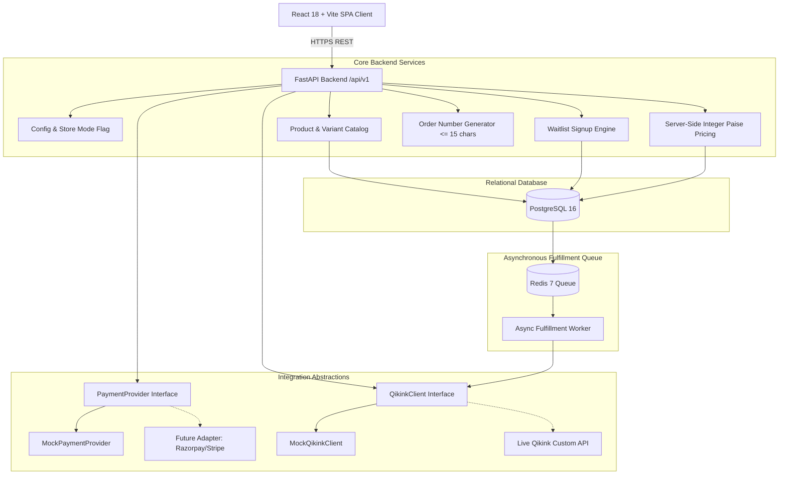

# VYOMIK System Architecture & Design Documentation

## 1. High-Level Architecture Overview

VYOMIK is built around clean boundaries, explicit data contracts, and strong decoupling between consumer-facing web traffic, payment transactions, and print-on-demand fulfillment.



---

## 2. Decoupled Payment Gateway Abstraction

The payment gateway provider is completely abstracted behind the `PaymentProvider` interface:

```python
class PaymentProvider(ABC):
    @property
    @abstractmethod
    def provider_name(self) -> str: pass

    @abstractmethod
    async def create_payment_order(self, request: CreatePaymentOrderRequest) -> CreatePaymentOrderResponse: pass

    @abstractmethod
    async def verify_payment(self, request: VerifyPaymentRequest) -> VerifyPaymentResponse: pass

    @abstractmethod
    async def process_refund(self, request: RefundRequest) -> RefundResponse: pass

    @abstractmethod
    async def parse_webhook(self, headers: Dict[str, str], body: bytes) -> Dict[str, Any]: pass
```

### Why this design?
1. **Zero Vendor Lock-in**: Switching from `MockPaymentProvider` to Razorpay, Cashfree, PhonePe, or Stripe requires **adding one adapter file** in `backend/app/integrations/payment/` and changing `PAYMENT_PROVIDER` in `.env`.
2. **Order Logic Stability**: The database schema and frontend order creation flows remain 100% untouched.
3. **Cash on Delivery (COD)**: Supported natively alongside prepaid flows without special branching in the checkout UI.

---

## 3. Financial Integrity: Integer Paise Representation

- In accordance with banking standards, all prices, discounts, delivery fees, and order amounts are stored and calculated as **integer Paise** (`1 INR = 100 Paise`).
- Floating point inaccuracies are completely avoided.
- Display helpers format Paise cleanly for the frontend (e.g., `119900` → `₹1,199`).

---

## 4. Launch Mode Feature Flag (`STORE_MODE`)

Configured via `STORE_MODE` in `.env` and exposed through `GET /api/v1/config`:

| Mode | UI Behavior | Checkout State |
|---|---|---|
| `coming_soon` | Announcement banner shows countdown to 8 Nov 2026. "Notify me at launch" triggers email modal saving to `waitlist_signups`. Category cards display inline coming soon panels. | Disabled with explanatory message. |
| `live` | Full product catalog, interactive size/color picker, active shopping bag drawer, and payment checkout enabled. | Enabled (prepaid + COD). |

